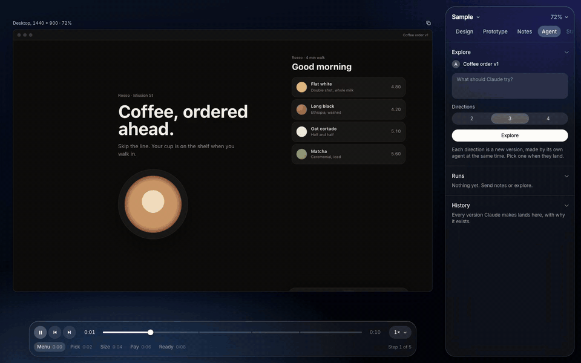

# Atelier

A design stage where you and a coding agent work on the same screens.



<sub>Explore, sped up: three directions, made at once, picked with a reason. [MP4](docs/explore.mp4)</sub>

You pin notes on a design and the agent answers them on a copy, beside the original, live. You ask for a direction
and three agents make three at once, side by side. You pick one and say why. Every version remembers what made it.

Designs are code: one small JavaScript file per design, with a timeline, so they move. Atelier plays them,
compares them, and keeps the conversation about them.

## What it needs

- **A Mac.** It's built and tested on macOS. Linux should work; Windows hasn't been tried.
- **Python 3.8 or newer** for the server. Nothing to install for it.
- **[Claude Code](https://claude.com/claude-code)**, signed in, for the agents. Run `claude` once and sign in; the
  Atelier runs it for you, with no API key to set. Or bring another agent (see Agents).
- **Google Chrome and Node**, only for exporting PNG, GIF and MP4.

## Start

```
git clone https://github.com/ericwangdesign/atelier
cd atelier
npm install          # only for exporting PNG, GIF and MP4
python3 serve.py
```

Open http://localhost:4321. The **Sample** project is a coffee order in two versions. Press Space to play it.

**[The manual](docs/manual.md)** shows every part of it, with pictures.

## The loop

1. **Note.** Press N and click a screen to pin a note, or drag to note an area. Press X to cut out an element
   instead; shift-click to gather several into one note.
2. **Send to Claude** (Notes tab). The design is copied as its next version, which appears beside the original at
   once. Claude works on the copy only, and the copy rebuilds on screen every time it saves. Each note gets a reply
   and is marked done; the reply links to the version it made.
3. **Explore** (Agent tab, or E). Say what to try and how many directions, two to four. Each one is a new version made
   by its own agent at the same time, each with its own angle (direct, bold, quiet, moving), all on screen together.
   With Focus on, they only redesign the focused part.
4. **Pick.** When the directions land, each screen offers Pick. Add a line on why. The others stay, dimmed.
5. **History** (Agent tab). Why each version exists: its parent, the notes or prompt that made it, the pick and the
   reason. Compare shows the before and after. **Share** writes it as a page for people who aren't designers: the
   two pictures, flip or slide between them, the notes and replies beside them.

6. **Taste** (its own tab). Every pick, with its reason, and every round of notes teaches Atelier what you like, in
   short lines you can read: "accent colour only on prices, selection and the main action". Every run reads them
   first. Edit a line and it's yours, × forgets it, and one switch turns the whole thing off.

Nothing you made is ever overwritten. Every round is a new version, so every change has a before and an after.

## Taste

After a pick or a round of notes lands, a small model (Claude Haiku, a few seconds, a fraction of a cent) reads your
profile and the new evidence, and either adds a line, says it's more sure of one, or drops one this contradicts.
Each line keeps where it came from, and how sure it is shows as dots. A line is about every design ("Everywhere") or
this project's own brand ("This project"); click to switch. Lines you write or edit are never dropped by learning.

When you explore, the first direction leans on your taste. The others know it, but their angle comes first, so
exploring still surprises you. The tab also counts which kind of direction you pick (direct, bold, quiet, moving).

The profile is `taste.json` in this folder, never committed. `ATELIER_TASTE_MODEL` picks the model that learns.

## Agents

The agent is Claude Code run headless (`claude -p`) in the project's `scenes/` folder, allowed to read and edit
files there and nothing else. Runs show on the screens they work on (a faint light circling the screen, and a line
above it that says what it's doing, with Stop) and in the Agent tab.

- `ATELIER_MODEL=sonnet python3 serve.py` picks the model.
- `ATELIER_AGENT="your-agent --flags" python3 serve.py` runs another agent instead. It gets the prompt on stdin;
  each line it prints shows as its activity. End its output with the JSON block the prompt asks for and replies land
  on the notes.
- Prefer your own agent session? Copy brief (Notes tab) puts every open note on the clipboard, with where it is,
  what's under it and the controls you moved. Or tell your agent to "check the notes": `AGENTS.md` says how.

## Projects

A project is any folder next to `atelier/` with a `scenes/` folder in it (or set `ATELIER_PROJECTS` to another
folder). The examples in `examples/` are projects too.

```
Projects/
  my-app/
    scenes/
      index.js          lists the designs:  scenes(['home-v1', 'home-v2']);
      home-v1.js        one file per design
      home-v2.js
      workspace.json    variants and control values you picked
      trail.json        why each version exists (worth committing)
      notes/            notes, snapshots, agent runs (never committed)
    exports/            PNG, GIF, MP4 and shared pages
  atelier/              this tool
```

**New project** (top of the panel, or on Home) makes `<name>/scenes/` from `starter/`. To add a design by hand, copy
a scene file, change it, and add its name to `index.js`. `starter/first.js` explains every attribute a scene can
animate with. A design can also be a running app: pick **URL** under Designs.

`scenes(['a-v1'], ['helpers'])` loads `scenes/helpers.js` before the designs, for code they share. A project's
typefaces go in `scenes/fonts.css`.

## On the stage

- **Compare.** Shift-click designs to put up to five on screen, lettered A to E, in step: step 3 always shows next to
  step 3. With two, View offers Swipe, Onion and Difference. Rows and Columns lay any two axes out as a grid
  (versions down, phone and desktop across).
- **Controls.** A scene can list knobs (`range`, `seg`, `color`, `toggle`) that set CSS variables or attributes. Copy
  values writes the ones you moved as a request to bake them in. Save variant keeps a set of values as its own
  design.
- **Focus.** F, then click an element: every screen crops to that part. Mark comparable parts with `data-focus`.
- **Duplicate.** The icon at a screen's top right copies its scene file as the next version, side by side.
- **Export.** Prototype › Export makes a PNG of the step you're on, or a GIF or MP4 of the flow, one file per screen.

## Keys

Space plays. ← → step, `,` `.` frame. N note, X cut, F focus, E explore. C compare, V view. 0 fits, 1 is 100%.
`\` hides the panel, H everything but the screens, R restarts.

## Files

- `index.html` Home: every project and its designs. `stage.html` the stage. `engine.js` plays a scene.
- `agent.js`, `agent.css` the agent on the stage: sending notes, exploring, picking, runs and history.
- `serve.py` the server: projects, notes, picks, exports. `agent.py` runs the agents. `page.py` writes shared pages.
- `taste.py`, `taste.js` the taste profile: learning from picks and notes, and the Taste tab.
- `capture.mjs` exports, in a hidden Chrome. `starter/` what a new project starts from. `examples/` sample projects.

Everything stays on your computer: the server only listens on 127.0.0.1.

## License

MIT. See [LICENSE](LICENSE).
