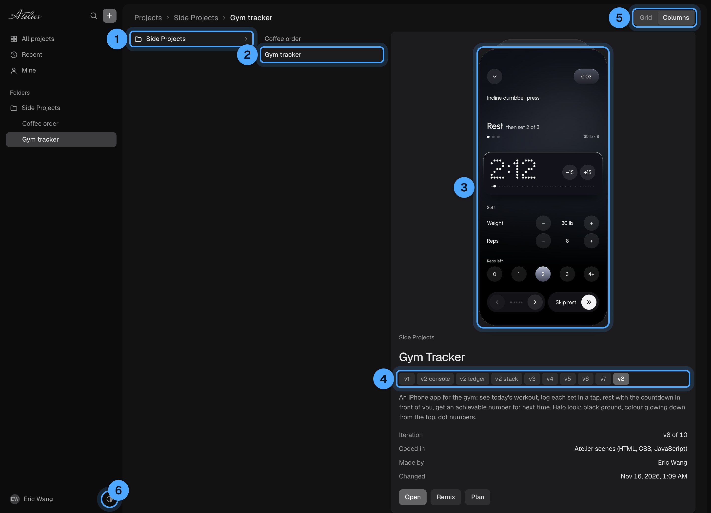
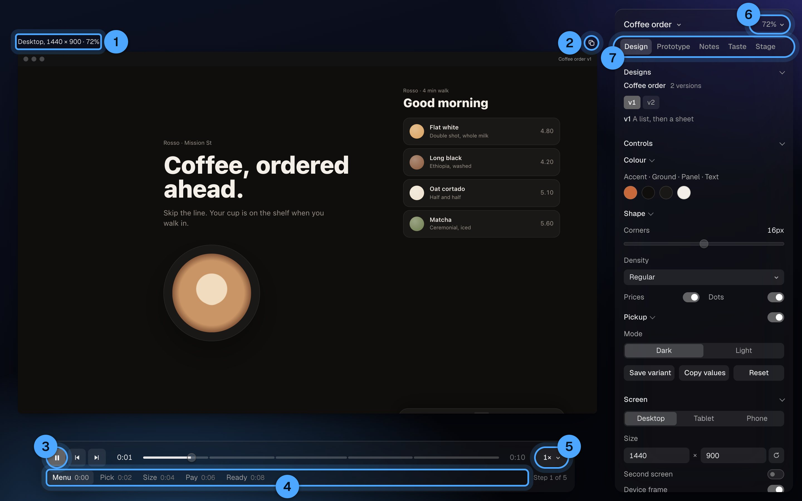
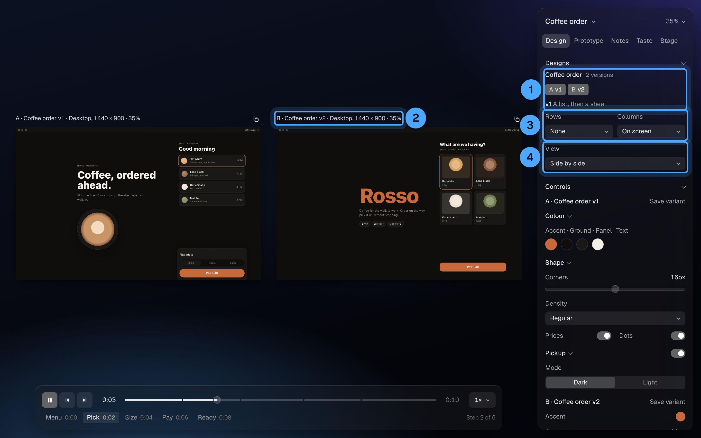
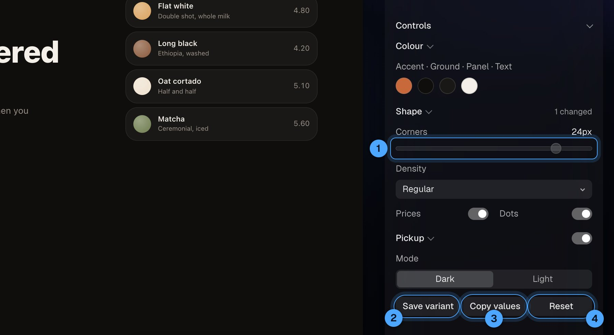
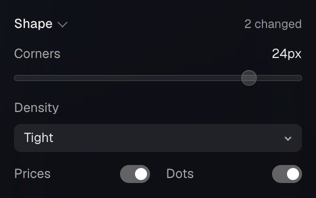
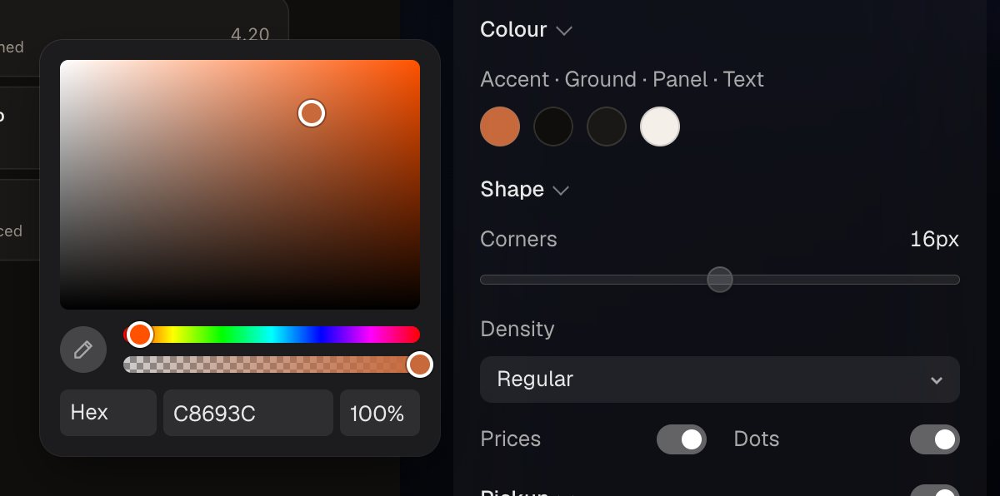
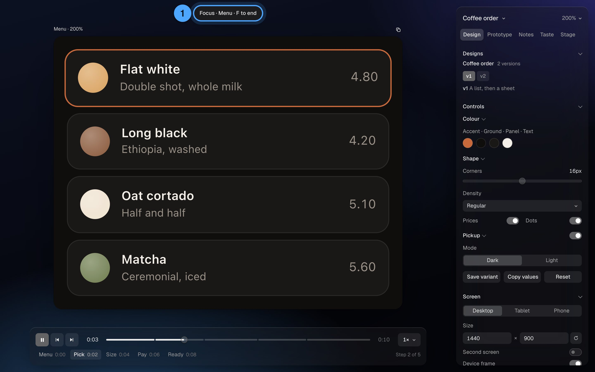
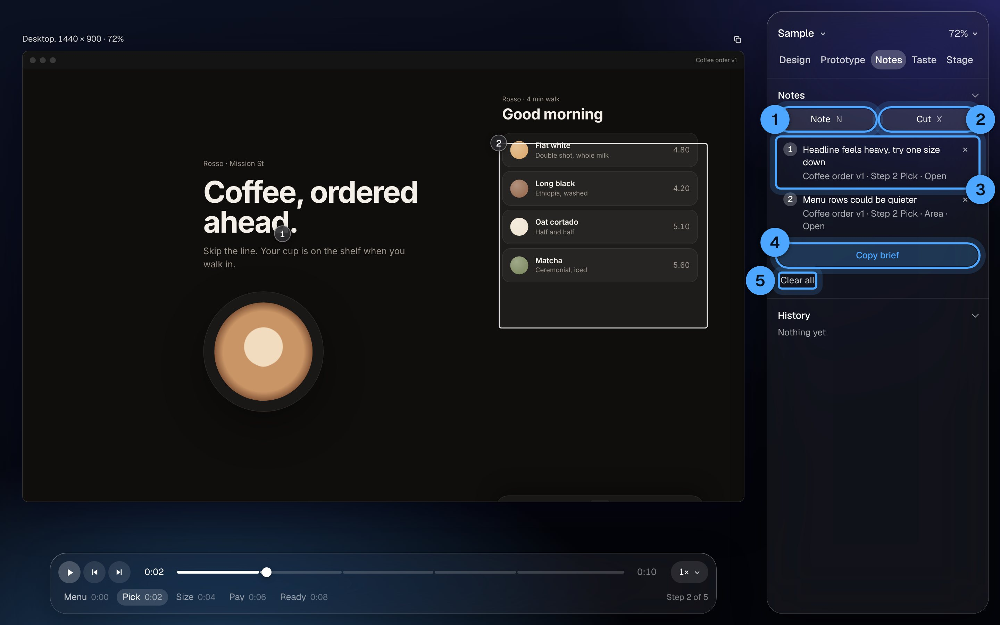
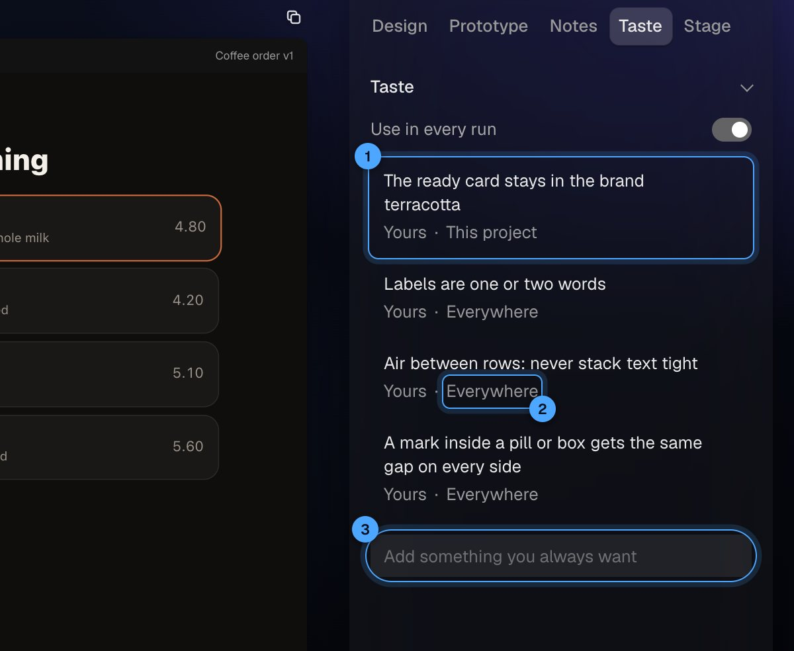

# The manual

Everything Atelier does, by where it lives. Type `atelier` in any terminal: it opens http://localhost:4321, and starts it first if it isn't running (`atelier stop` stops it). Without the command: `python3 serve.py` in this folder, Ctrl-C stops it. The blue numbers in each picture match the list under it.

## Home

1. **A folder.** One per folder next to `atelier/`. Click it to see its projects in the next column. The sidebar lists the same folders, under All projects, Recent and Mine.
2. **A project.** Click it and its newest design is chosen.
3. **The design**, running live. Click it to open it on the stage.
4. **Its iterations**, as chips, the one shown in ink. Pick one to see it here. Under the facts, **Open** puts it on the stage and **Remix** copies a brief for your own agent session.
5. **Grid or Columns.** Grid shows a card per project; Columns keeps the path you took on screen.
6. **Theme:** Auto, Light or Dark, one setting for home and the stage.

**New project** and **New folder** sit at the top right. Search is at the top of the sidebar. When Atelier has changed since you last looked, a card at the top says what's new, once; **Got it** puts it away.

## The stage

1. **Caption.** The screen's size and zoom. Drag it to move the screen; double-click puts it back.
2. **Duplicate.** Copies the design as its next version, side by side, for a change no control covers.
3. **Play and step.** Space plays, ← → step, `,` `.` move one frame.
4. **Steps.** Click one to jump there. R restarts.
5. **Speed.** 1× menu, with Loop under Prototype.
6. **Zoom.** 0 fits, 1 is 100%.
7. **The panel's tabs.** Design, Prototype, Notes, Taste, Stage. When they don't all fit, the row scrolls sideways (drag, or scroll over it) and fades at the side with more. `\` hides the panel, H shows screens only.

Drag any edge of a desktop screen to resize it. Scroll on empty canvas to pan.

**Screen** (Design tab, at the bottom): Desktop, Tablet, Phone, or any size. Rotate swaps width and height. **Second screen** adds a phone beside a desktop. **Device frame** turns the window chrome and phone bezel on or off. On phones and tablets the design runs the full height, as on the real thing: the status bar and home indicator float over it, in black or white to suit what's under them. A design keeps clear of them with `var(--safe-top)` and `var(--safe-bottom)`. The size is kept per project.

## Designs and compare

1. **The designs list.** One item per design: its name, how many versions, the versions as chips, and a line on the one shown. Click a chip to show it; shift-click (or ⌘-click) adds it beside, up to five. With several on screen, each chip gets its letter, A to E.
2. **The letter** above each screen matches its chip.
3. **Rows and Columns.** Any two axes as a grid: Versions down × Screen across shows v1 and v2 at desktop and phone at once.
4. **View**, with exactly two: Side by side, **Swipe** (drag the divider), **Onion** (opacity slider), **Difference** (only changed pixels show).

They play in step: step 3 always next to step 3. Four or five wide screens wrap into two rows; phones stay in one. **C** goes back to one design or adds the next, **V** cycles the view. Rows and Columns only show with two or more designs on screen.

## Controls and variants

1. **A control.** Sliders, pills, dropdowns, colours, toggles: whatever the scene lists. Moving one only changes what you see. Colours next to each other share one row of swatches; short toggles pair up two to a row.
2. **Save variant** keeps the current values as their own design, under its scene. With one design on screen it sits next to Copy values and Reset. Double-click a variant to rename it, × removes it.
3. **Copy values** puts the moved ones on the clipboard as a request to bake them in.
4. **Reset** puts them back.

**Groups.** A scene can fold its controls into named groups. Click a group's name to fold it. Its head says how many of its controls you've changed, and a group can have its own switch that turns that part on or off.

**The colour picker.** Click any swatch: a square for saturation and brightness, a hue bar, an opacity bar, an eyedropper to take a colour from anywhere on screen, and the value as Hex, RGB or HSB with the opacity in %. The design changes while you drag.

## Focus

Press F, then click an element: every screen crops to that part, enlarged, on the same step.

1. **Focus** names what it's on, at the top of the stage. Press F again, or Esc, to end it.

## Notes

On the screen, a blue numbered marker is a note, its sharp corner on the spot noted, and a dashed box is an area note. They only show on the step they were left on.

1. **Annotate** (N): point at the screen and the element under the pointer is outlined and named. Click to note that element, or drag a box to note an area; an area records every element inside and their text. ↑ ↓ walk to its parent and back. Shift-click several, then Return, for one note. Hold ⌥ to click the design itself. On a design that frames a live page, the note is on the element in the page. Esc or **Done** in the bar at the top ends it.
2. **The note**, with a picture of what it's on. Click to find its marker. **Open** opens the file at that spot.
3. **Copy brief** copies every open note as a brief for your own agent session. The bar at the top while annotating has it too, with the count. See No agent inside, below.
4. **Clear all** deletes every note, after asking.

Click a pin to edit, resolve or delete it; drag a pin to move it and it re-reads what's under it. Notes group into sittings: a gap over half an hour starts a new one. Everything is saved to `<project>/scenes/notes/`.

**Draw on a note.** While a note is open, the pen, ellipse, rectangle and arrow under its text draw on the screen in blue. ⌘Z takes back the last mark; Esc puts the tool down. The drawing is kept with the note, goes into its snapshot, and the brief names what it's on ("Circled …", "Arrow from … to …"). It only shows while the note is open or you point at its pin.

**Edit words in place.** In note mode, double-click words on a screen and type over them. Return makes a note with the exact old and new words (the brief gives them word for word); Esc puts them back. The new words stay on screen until the next version lands, and go if you delete the note.

**Edit CSS.** On a note that cut one element, **Edit CSS** opens its gap, padding, margin, radius, size, weight, colour and fill. A change shows on that element at once; ↑ ↓ step a number (⇧ by 10), a colour opens the colour picker. The note keeps each value as old → new for the brief, and the change stays on screen until its version lands. Esc takes the changes back.

## No agent inside

Atelier has no agent of its own. Notes leave it as a brief, and the work happens in your own agent session, outside.

1. **Copy brief** (Notes tab) puts every open note on the clipboard: where it is, what's under it, the words or values you changed and the controls you moved.
2. Paste it into your session. Or tell the session to "check the notes": `AGENTS.md` says how.
3. The session saves the change as the design's next version, so the original is never touched. It shows in the layer list, ready to compare.
4. Each note it handled gets its reply and is struck through, within two seconds.

## History

At the foot of the Notes tab: why each version exists, with the notes behind it. **Compare** shows a version beside its parent. **Share** writes a page for someone who isn't a designer: flip or slide between before and after, with the notes and replies beside it, plus a Writing canvas block. Both land in `<project>/exports/`.

## Taste

What you like, in lines you can check. Every agent session reads it before design work.

1. **A line**, in words you can check. Click the words to edit them. × forgets it.
2. **Everywhere or This project.** Click to switch. A line about this product's own brand stays with this project.
3. **Add** something you always want, then Return.

It's one list for everything, not only Atelier: every agent session reads it (as `taste.md` next to `taste.json`), and when you give a session feedback that's a rule, it adds the line here as yours. Nothing inside Atelier learns or rewrites it.

## Export

Prototype › Export: **PNG** of this step at 2×, **GIF** or **MP4** of the whole flow, one file per screen, without the wallpaper or frame. Downloads, and a copy stays in `<project>/exports/`.

## Stage tab

Wallpaper (Dark, Light, Glow, Colour, or drop any image on the page), Dim, glass Blur and Tint, Liquid glass tuning, and the list of keys.

## Projects and files

- **New project:** the project name menu at the top of the panel, or Home. It makes `Projects/<name>/scenes/` from the starter. A project for a client that has a folder goes in it instead: `Projects/<client>/<project>/scenes/`.
- A design is one file in `scenes/`, listed in `scenes/index.js`. `starter/first.js` explains every animation attribute.
- A scene can set `size: [1440, 900]`: the screen its project opens on, until you pick another.
- `scenes(['a-v1'], ['helpers'])` loads `scenes/helpers.js` first, for code designs share. Typefaces go in `scenes/fonts.css`.
- `scenes/trail.json` is the history: worth committing. `scenes/notes/` never is.

## Keys

Space play · ← → step · `,` `.` frame · R restart · 0 fit · 1 100% · C compare · V view · N note · X cut · F focus · `\` panel · H screens only · ⌥N a note on Atelier itself · Esc leaves any mode.

**A note on Atelier itself:** ⌥N, then click a spot or drag an area of the tool (a button, the panel, a card) and say what's wrong. It goes to your agent session to fix in Atelier, not to a design, and stays pinned there with its answer until you clear it. The same works on every vault page.

## When something's off

- **"Already running":** Atelier is already up (often started by an agent session): `atelier` opens it. To restart it, `atelier stop`, then `atelier`.
- **Export fails:** run `npm install` in the atelier folder once.
- **A design is blank:** it's probably on step 0 of an entrance animation. Press → once.
