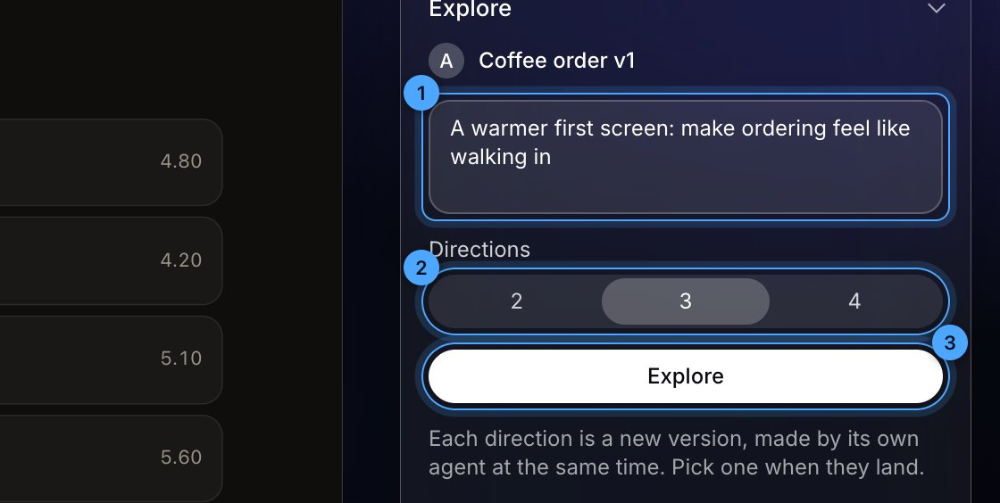
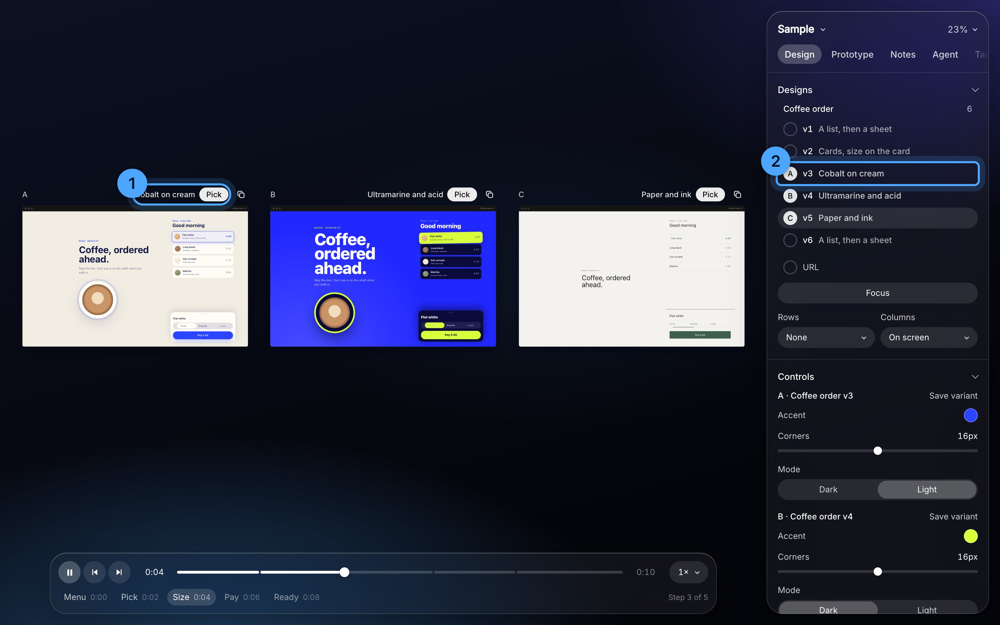
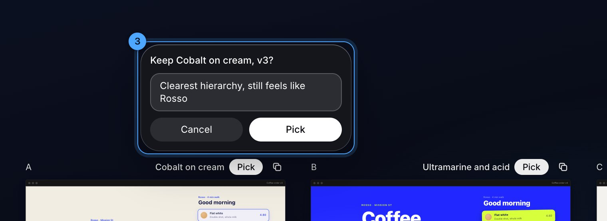
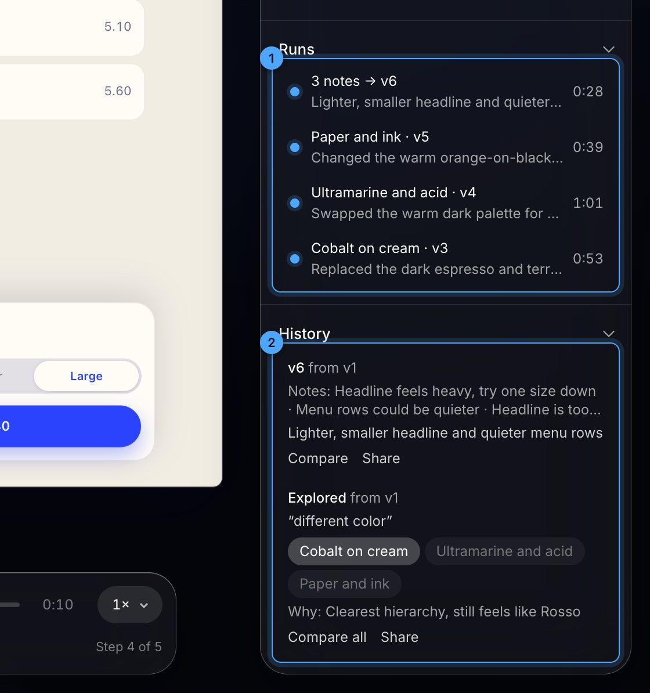

# The manual

Everything Atelier does, by where it lives. Start it with `python3 serve.py` in this folder and open http://localhost:4321. Ctrl-C stops it. The blue numbers in each picture match the list under it.

## Home

1. **The project.** Its name or Open goes in. A blue spinner here means Claude is working on it right now.
2. **A design.** Click to open it. Move the pointer across the card to skim its versions: left is v1, right is the newest.
3. **Wallpaper** for every page.
4. **New project.**

Filter with /, and sort by Recent or Name, once there's more than one project.

## The stage

1. **Caption.** The screen's size and zoom. Drag it to move the screen; double-click puts it back.
2. **Duplicate.** Copies the design as its next version, side by side, for a change no control covers.
3. **Play and step.** Space plays, ← → step, `,` `.` move one frame.
4. **Steps.** Click one to jump there. R restarts.
5. **Speed.** 1× menu, with Loop under Prototype.
6. **Zoom.** 0 fits, 1 is 100%.
7. **The panel's tabs.** Design, Prototype, Notes, Agent, Stage. When they don't all fit, the row scrolls sideways (drag, or scroll over it) and fades at the side with more. `\` hides the panel, H shows screens only.

Drag any edge of a desktop screen to resize it. Scroll on empty canvas to pan.

**Screen** (Design tab, at the bottom): Desktop, Tablet, Phone, or any size. Rotate swaps width and height. **Second screen** adds a phone beside a desktop. **Device frame** turns the window chrome and phone bezel on or off. On phones and tablets the design runs the full height, as on the real thing: the status bar and home indicator float over it, in black or white to suit what's under them. A design keeps clear of them with `var(--safe-top)` and `var(--safe-bottom)`. The size is kept per project.

## Designs and compare

1. **The layer list.** One row per version: the version, then what it is. Click shows one; shift-click (or ⌘-click) adds it beside, up to five. A small dot marks the one on screen. With several on screen, each gets its letter instead, A to E.
2. **The letter** above each screen matches the circle in the list.
3. **Rows and Columns.** Any two axes as a grid: Versions down × Screen across shows v1 and v2 at desktop and phone at once.
4. **View**, with exactly two: Side by side, **Swipe** (drag the divider), **Onion** (opacity slider), **Difference** (only changed pixels show).

They play in step: step 3 always next to step 3. Four or five wide screens wrap into two rows; phones stay in one. **C** goes back to one design or adds the next, **V** cycles the view. **URL** puts a running app in the screen.

## Controls and variants

1. **A control.** Sliders, pills, colours, toggles: whatever the scene lists. Moving one only changes what you see.
2. **Save variant** keeps the current values as their own design, under its scene. Double-click a variant to rename it, × removes it.
3. **Copy values** puts the moved ones on the clipboard as a request to bake them in.
4. **Reset** puts them back.

## Focus

Press F, then click an element: every screen crops to that part, enlarged, on the same step.

1. **Focus** names what it's on. Click it, press F again, or Esc to end it.

With Focus on, Explore only redesigns that part.

## Notes

On the screen, a grey numbered dot is a pinned note and a box is an area note. They only show on the step they were left on.

1. **Note** (N): click a screen to pin one, or drag a box to note an area. An area records every element inside and their text.
2. **Cut** (X): point at an element and click. ↑ ↓ walk to its parent and back. Shift-click several, then Return, to cut them into one note.
3. **The note.** Click to find its pin. **Open** opens the file at that spot.
4. **Send to Claude**, with the count of open notes. See Claude, below.
5. **Copy brief** copies every open note as a brief.
6. **Clear all** deletes every note, after asking.

Click a pin to edit, resolve or delete it; drag a pin to move it and it re-reads what's under it. Notes group into sittings: a gap over half an hour starts a new one. Everything is saved to `<project>/scenes/notes/`.

## Claude

**Send to Claude** (Notes tab) sends every open note. One new version per design, with all of that design's notes in it: three notes on v1 make one v2, not three. Notes on two different designs start two agents, one for each.

1. **What it's doing**, on the line above the screen, with the time and × to stop it.
2. **A faint light circles the screen** while Claude works. The copy rebuilds on screen every time Claude saves.
3. **Runs** (Agent tab): every agent, live or done. Click one to put its versions on screen.

What happens:
1. The design is copied as its next version, beside the original. Your original is never touched.
2. Each note gets Claude's reply and is struck through. The reply's version link shows the before and after.
3. A run that fails before changing anything removes its copy.

## Explore

Agent tab, or E.

1. **Type what to try.** ⌘Return also starts it.
2. **Directions:** 2, 3 or 4. Each one takes a different angle: direct, bold, quiet, moving.
3. **Explore.** They run at the same time, each on its own copy, all on screen. About 40 to 60 seconds each; Claude reports about $0.45 to $0.50 a direction.

## Pick

1. **Pick**, on the line above each direction, next to its name.
2. **The list** names each direction too.

3. **Why** (optional), then Return. The pick gets a ★ in the list; the others stay, dimmed.

## History

1. **Runs:** what every agent did, and how long it took.
2. **History:** why each version exists. The prompt, the directions with ★ on the pick, and your reason. **Compare** shows a version beside its parent, **Compare all** shows an exploration's directions together. **Share** writes a page for someone who isn't a designer: flip or slide between before and after, with the notes and replies beside it, plus a Writing canvas block. Both land in `<project>/exports/`.

## Taste

What Claude has learned you like, from your picks and your notes. Every run reads it first.

1. **Use in every run.** Switch it off and runs ignore your taste until you switch it back.
2. **A line**, in words you can check. Click the words to edit them: an edited line is yours, and learning never drops it. × forgets it.
3. **How sure**, as dots, on lines Claude learned. Each pick or round of notes that agrees adds one.
4. **Everywhere or This project.** Click to switch. A line about this product's own brand stays with this project.
5. **Add** something you always want, then Return.
6. **Directions you pick:** which kind of direction you chose, out of the times it was offered.

How it learns: when a pick lands (with your reason), or a round of notes comes back, a small model reads your profile and what just happened. It adds a line, grows one it already had, or drops one this goes against. A toast says which: "Learned: …" or "More sure: …". It takes a few seconds and a fraction of a cent.

When you explore, the first direction leans on your taste. The others know it, but their angle comes first, so exploring still surprises you.

## Export

Prototype › Export: **PNG** of this step at 2×, **GIF** or **MP4** of the whole flow, one file per screen, without the wallpaper or frame. Downloads, and a copy stays in `<project>/exports/`.

## Stage tab

Wallpaper (Dark, Light, Glow, Colour, or drop any image on the page), Dim, glass Blur and Tint, Liquid glass tuning, and the list of keys.

## Projects and files

- **New project:** the project name menu at the top of the panel, or Home. It makes `Projects/<name>/scenes/` from the starter.
- A design is one file in `scenes/`, listed in `scenes/index.js`. `starter/first.js` explains every animation attribute.
- A scene can set `size: [1440, 900]`: the screen its project opens on, until you pick another.
- `scenes(['a-v1'], ['helpers'])` loads `scenes/helpers.js` first, for code designs share. Typefaces go in `scenes/fonts.css`.
- `scenes/trail.json` is the history: worth committing. `scenes/notes/` never is.

## Keys

Space play · ← → step · `,` `.` frame · R restart · 0 fit · 1 100% · C compare · V view · N note · X cut · F focus · E explore · `\` panel · H screens only · Esc leaves any mode.

## When something's off

- **"Claude needs you to sign in":** run `claude` in a terminal, then `/login`.
- **"Address already in use":** an old server still has the port. `lsof -ti tcp:4321 | xargs kill`, then start again.
- **Export fails:** run `npm install` in the atelier folder once.
- **A design is blank:** it's probably on step 0 of an entrance animation. Press → once.
