# The manual

Everything Atelier does, by where it lives. Type `atelier` in any terminal: it opens http://localhost:4321, and starts it first if it isn't running (`atelier stop` stops it). Without the command: `python3 serve.py` in this folder, Ctrl-C stops it. The blue numbers in each picture match the list under it.

## Home

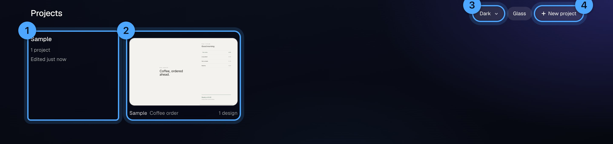

1. **The client.** One row per folder next to `atelier/`, with how many projects it has. A blue spinner here means an agent is working on one right now.
2. **A project.** One card per project, with how many designs it has. Move the pointer across the card to skim its designs, each at its newest version; a click opens the one under the pointer. Versions show on the stage, not here.
3. **Wallpaper** for every page.
4. **New project.**

Filter with /, and sort by Recent or Name, once there's more than one project. When Atelier has changed since you last looked, a card at the top says what's new, once; **Got it** puts it away.

## The stage

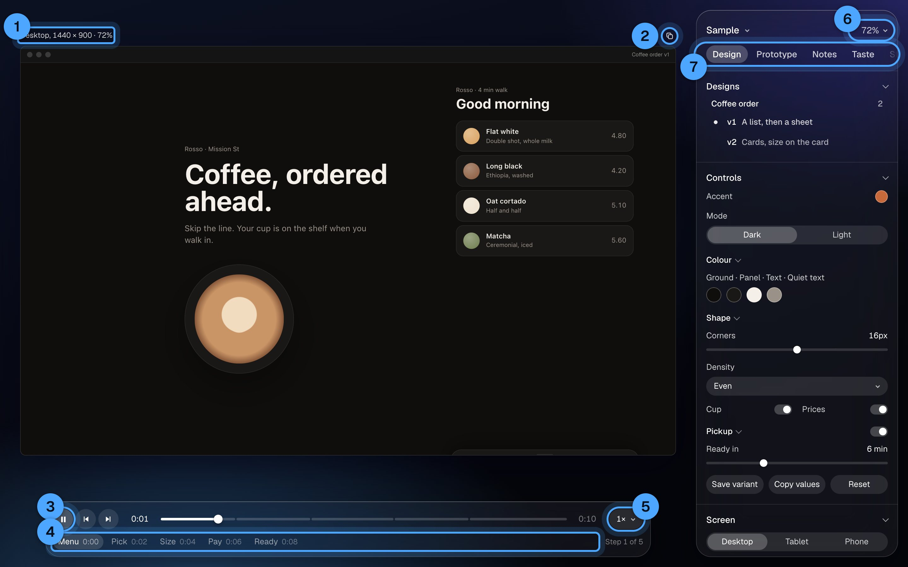

1. **Caption.** The screen's size and zoom. Drag it to move the screen; double-click puts it back.
2. **Duplicate.** Copies the design as its next version, side by side, for a change no control covers.
3. **Play and step.** Space plays, ← → step, `,` `.` move one frame.
4. **Steps.** Click one to jump there. R restarts.
5. **Speed.** 1× menu, with Loop under Prototype.
6. **Zoom.** 0 fits, 1 is 100%.
7. **The panel's tabs.** Design, Prototype, Notes, Taste, Stage. When they don't all fit, the row scrolls sideways (drag, or scroll over it) and fades at the side with more. `\` hides the panel, H shows screens only.

Drag any edge of a desktop screen to resize it. Scroll on empty canvas to pan.

**Screen** (Design tab, at the bottom): Desktop, Tablet, Phone, or any size. Rotate swaps width and height. **Second screen** adds a phone beside a desktop. **Device frame** turns the window chrome and phone bezel on or off. On phones and tablets the design runs the full height, as on the real thing: the status bar and home indicator float over it, in black or white to suit what's under them. A design keeps clear of them with `var(--safe-top)` and `var(--safe-bottom)`. The size is kept per project.

## Designs and compare

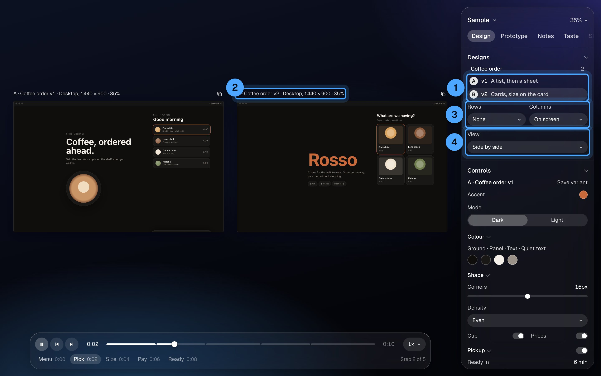

1. **The layer list.** One row per version: the version, then what it is. Click shows one; shift-click (or ⌘-click) adds it beside, up to five. A small dot marks the one on screen. With several on screen, each gets its letter instead, A to E.
2. **The letter** above each screen matches the circle in the list.
3. **Rows and Columns.** Any two axes as a grid: Versions down × Screen across shows v1 and v2 at desktop and phone at once.
4. **View**, with exactly two: Side by side, **Swipe** (drag the divider), **Onion** (opacity slider), **Difference** (only changed pixels show).

They play in step: step 3 always next to step 3. Four or five wide screens wrap into two rows; phones stay in one. **C** goes back to one design or adds the next, **V** cycles the view. Rows and Columns only show with two or more designs on screen.

## Controls and variants

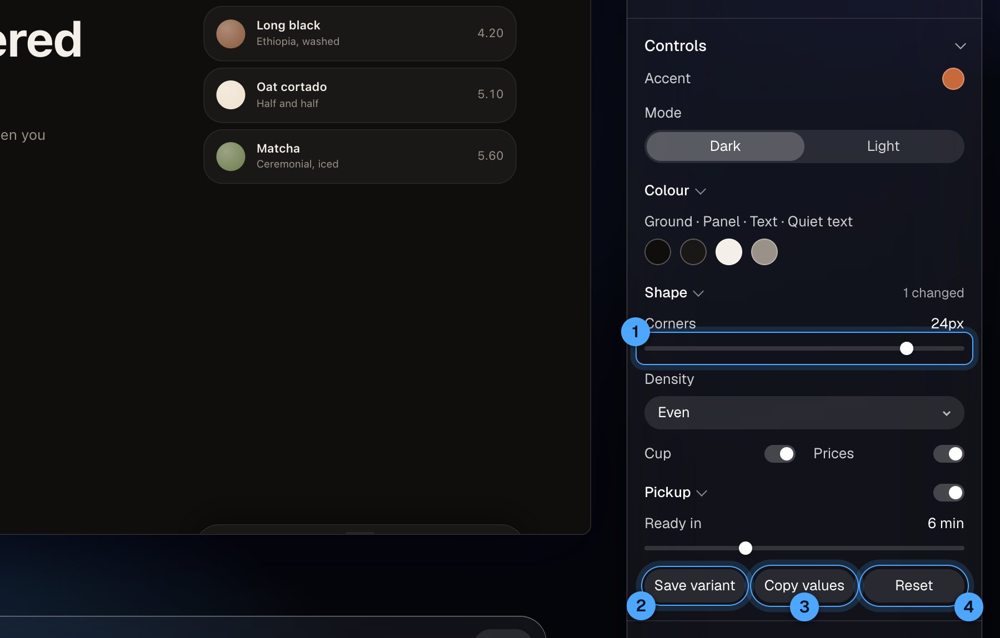

1. **A control.** Sliders, pills, dropdowns, colours, toggles: whatever the scene lists. Moving one only changes what you see. Colours next to each other share one row of swatches; short toggles pair up two to a row.
2. **Save variant** keeps the current values as their own design, under its scene. With one design on screen it sits next to Copy values and Reset. Double-click a variant to rename it, × removes it.
3. **Copy values** puts the moved ones on the clipboard as a request to bake them in.
4. **Reset** puts them back.

**Groups.** A scene can fold its controls into named groups. Click a group's name to fold it. Its head says how many of its controls you've changed, and a group can have its own switch that turns that part on or off.

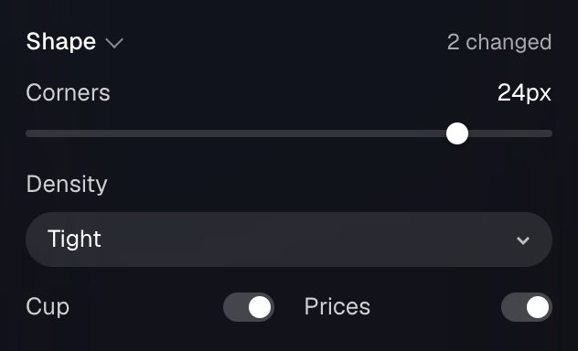

**The colour picker.** Click any swatch: a square for saturation and brightness, a hue bar, an opacity bar, an eyedropper to take a colour from anywhere on screen, and the value as Hex, RGB or HSB with the opacity in %. The design changes while you drag.

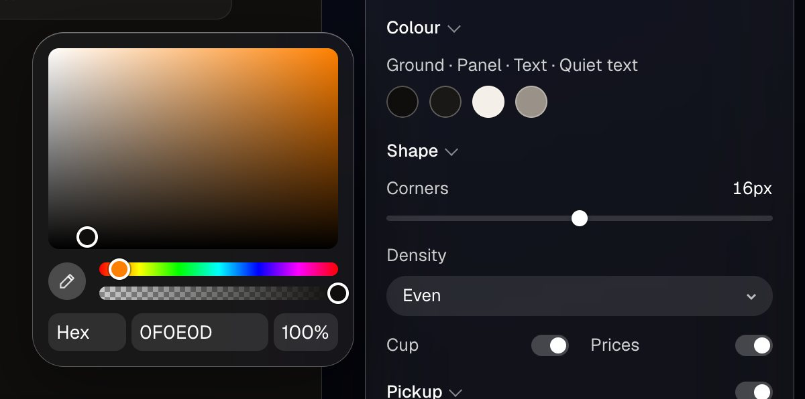

## Focus

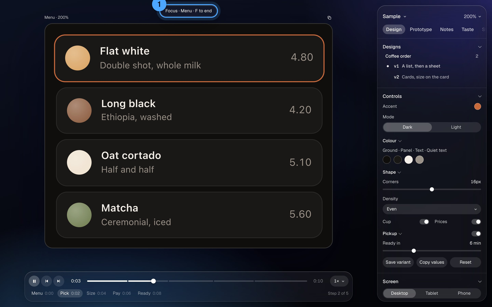

Press F, then click an element: every screen crops to that part, enlarged, on the same step.

1. **Focus** names what it's on, at the top of the stage. Press F again, or Esc, to end it.

## Notes

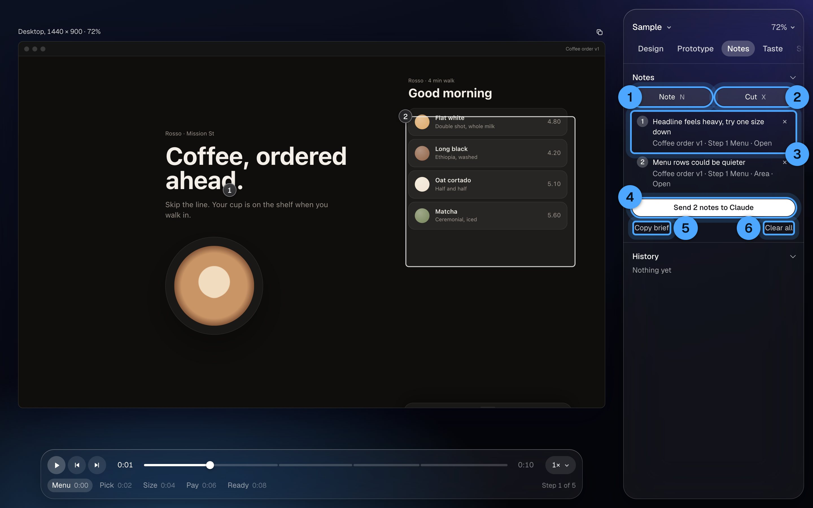

On the screen, a grey numbered dot is a pinned note and a box is an area note. They only show on the step they were left on.

1. **Note** (N): click a screen to pin one, or drag a box to note an area. An area records every element inside and their text. Select words on a screen and press N to note those exact words. The wheel still scrolls the design; hold ⌥ to click or use it without leaving note mode. On a design that frames a live page, the note is on the element in the page.
2. **Cut** (X): point at an element and click. ↑ ↓ walk to its parent and back. Shift-click several, then Return, to cut them into one note.
3. **The note.** Click to find its pin. **Open** opens the file at that spot.
4. **Send to agent**, with the count of open notes. See Agents, below.
5. **Copy brief** copies every open note as a brief.
6. **Clear all** deletes every note, after asking.

Click a pin to edit, resolve or delete it; drag a pin to move it and it re-reads what's under it. Notes group into sittings: a gap over half an hour starts a new one. Everything is saved to `<project>/scenes/notes/`.

**`/try` in a note.** Type `/` in a note and it offers `/try 3`: Tab takes it.

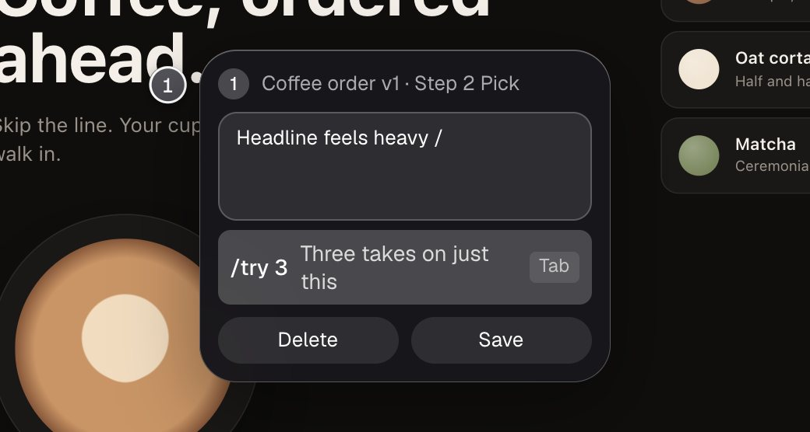

A note with `/try 3` isn't done with the rest: it gets three takes on just that part, with everything else on screen held still, and you pick one. `/try 2` and `/try 4` work too. In the list the note shows a blue "3 takes".

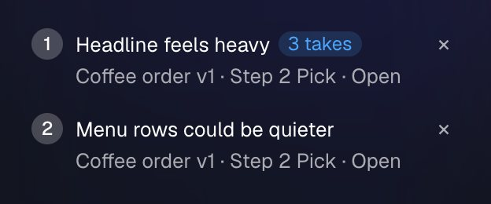

## Agents

**Send to agent** (Notes tab) sends every open note to your coding agent (Claude Code unless you pick another; see the README). Plain notes are done first, together: one new version per design with all of its plain notes in it, so three notes on v1 make one v2, not three. Notes on two different designs start two agents, one for each.

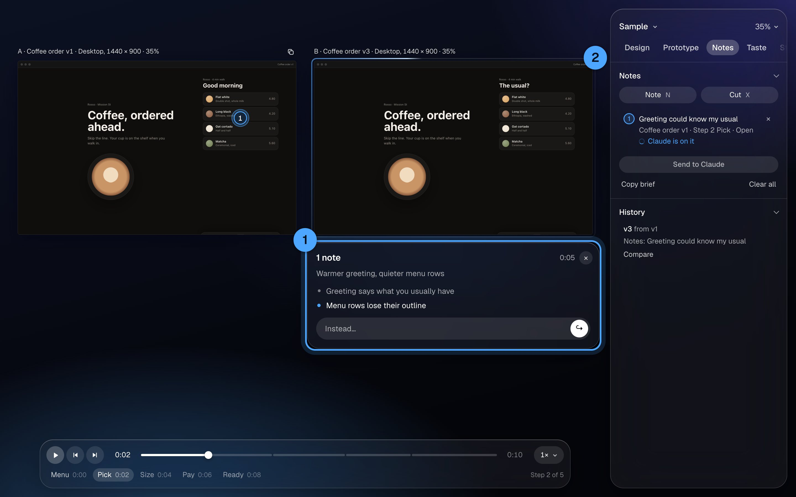

1. **A card under the screen**, on the canvas: the agent's plan, the last steps it made and the one it's on now (blue). It works one visible change at a time, so the screen above changes with each step and flashes softly when it does. × stops it.
2. **A faint light circles the screen** while the agent works. The copy rebuilds on screen every time it saves.

What happens:
1. The design is copied as its next version, beside the original. Your original is never touched.
2. Each note gets the agent's reply and is struck through. The reply's version link shows the before and after.
3. A run that fails before changing anything removes its copy.
4. **Instead…** on the card redirects that agent: type what it should do instead and press Return. Only that agent stops; it carries on from where it was, in the same session, with your line. The others keep going. The card and History keep the line as ↪.

## Takes on a /try note

When the plain notes have landed, each `/try` note gets its takes, one note at a time, on top of the new version. The version they start from and the takes go on screen side by side. Each take changes only what the note is about.

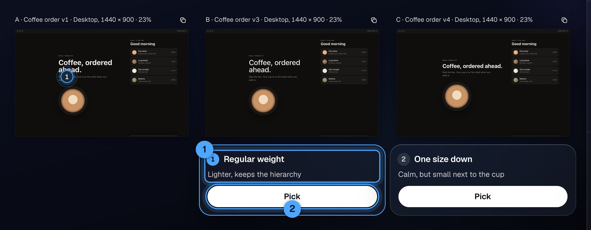

1. **The critic.** When every take has landed, Atelier takes a picture of each and a critic ranks them against your taste. Each card gets its place, a few words of why, and a blue 1 on the top pick ("close call" when the top two are near). It never picks for you. About 20 seconds and 3 cents.
2. **Pick** on a card, say why in one line (or don't), Return. The note is answered with the take you picked, and the next `/try` note starts from it. The others stay in the list, dimmed.

A take costs about what a plain round does: 40 to 80 seconds and $0.30 to $0.40. Walked away while they ran? Takes waiting for a pick show on the vault's Today under Needs you, with a link back here.

## History

At the foot of the Notes tab: why each version exists. A round of notes, or a note's takes with ★ on the pick and your reason. **Compare** shows a version beside its parent, **Compare all** shows a note's takes together. **Share** writes a page for someone who isn't a designer: flip or slide between before and after, with the notes and replies beside it, plus a Writing canvas block. Both land in `<project>/exports/`.

## Taste

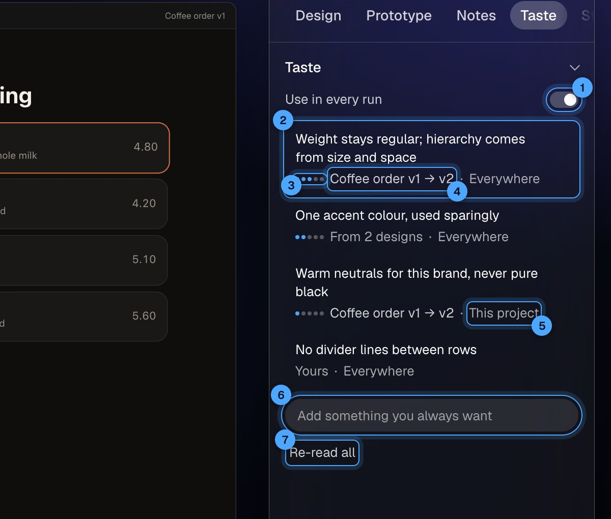

What the agents have learned you like, from how your designs changed. Every run reads it first.

1. **Use in every run.** Switch it off and runs ignore your taste until you switch it back.
2. **A line**, in words you can check. Click the words to edit them: an edited line is yours, and learning never drops it. × forgets it.
3. **How sure**, as dots, on lines it learned: one for each design that backs it.
4. **Where it came from.** The design it was learned from: click it to see that design's first and latest versions side by side.
5. **Everywhere or This project.** Click to switch. A line about this product's own brand stays with this project.
6. **Add** something you always want, then Return.
7. **Re-read all** relearns everything from every design's history. Lines you wrote or edited stay.

It's one list for everything, not only Atelier: every agent session reads it before design work (as `taste.md` next to `taste.json`), and when you give a session feedback that's a rule, it adds the line here as yours.

How it learns: each time a version lands from your notes, or you pick a take, a small model reads your profile and that design's whole journey so far: every version from the first, the notes behind each, your redirects, which take you picked over which, and why. What you asked for more than once and what you pulled back say the most. It adds a line, backs one it already had, or drops one this goes against. A toast says which: "Learned: …" or "More sure: …". It takes a few seconds and a fraction of a cent. Rereading the same design never counts twice.

## Export

Prototype › Export: **PNG** of this step at 2×, **GIF** or **MP4** of the whole flow, one file per screen, without the wallpaper or frame. Downloads, and a copy stays in `<project>/exports/`.

## Stage tab

Wallpaper (Dark, Light, Glow, Colour, or drop any image on the page), Dim, glass Blur and Tint, Liquid glass tuning, and the list of keys.

## Projects and files

- **New project:** the project name menu at the top of the panel, or Home. It makes `Projects/<name>/scenes/` from the starter. A project for a client that has a folder goes in it instead: `Projects/<client>/<project>/scenes/`.
- A design is one file in `scenes/`, listed in `scenes/index.js`. `starter/first.js` explains every animation attribute.
- A scene can set `size: [1440, 900]`: the screen its project opens on, until you pick another.
- `scenes(['a-v1'], ['helpers'])` loads `scenes/helpers.js` first, for code designs share. Typefaces go in `scenes/fonts.css`.
- `scenes/trail.json` is the history: worth committing. `scenes/notes/` never is.

## Keys

Space play · ← → step · `,` `.` frame · R restart · 0 fit · 1 100% · C compare · V view · N note · X cut · F focus · `\` panel · H screens only · ⌥N a note on Atelier itself · Esc leaves any mode.

**A note on Atelier itself:** ⌥N, then click a spot or drag an area of the tool (a button, the panel, a card) and say what's wrong. It goes to your agent to fix in Atelier, not to a design, and stays pinned there with its answer until you clear it. The same works on every vault page.

## When something's off

- **"Claude needs you to sign in":** run `claude` in a terminal, then `/login`.
- **"Already running":** Atelier is already up (often started by an agent session): `atelier` opens it. To restart it, `atelier stop`, then `atelier`.
- **Export fails:** run `npm install` in the atelier folder once.
- **A design is blank:** it's probably on step 0 of an entrance animation. Press → once.
